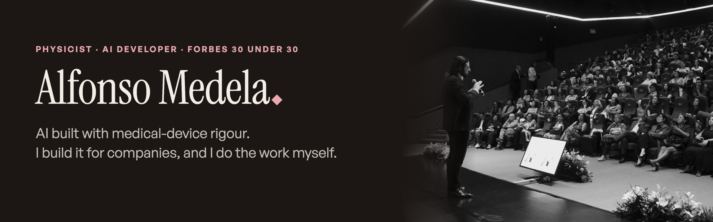

<a href="https://alfonsomedela.com/">
  <picture>
    <source media="(prefers-color-scheme: dark)" srcset="assets/banner-dark.jpg">
    <source media="(prefers-color-scheme: light)" srcset="assets/banner-light.jpg">
    
  </picture>
</a>

### I built AI good enough to pass medical certification. Now I build it for companies.

I'm a physicist. From 2017 to 2026 I led the AI of [Legit.Health](https://legit.health/): co-founder and CTO, then Chief AI Officer, and Technical Director & PRRC of its CE-marked medical device, certified class IIb under the EU MDR and used by 2,500+ clinicians. Before that I was a computer-vision researcher at TECNALIA (plant disease, histology, industry) and a BI analyst at BBVA.

Now I'm independent. I build models, data pipelines and evaluation for a few companies at a time, and I do the work myself.

| | |
|---|---|
| **Research** | Few-shot learning: models that learn from tens of examples, not millions. 29 papers · 847 citations · h-index 10. My most-cited paper (435 citations) applies it to plant disease from field photos. |
| **Proof** | Forbes 30 Under 30, Spain 2024 and Europe 2025 (Science & Healthcare) · TEDxUDeusto · 70+ stages |
| **Try it** | [Five photos per class, in your browser](https://alfonsomedela.com/work#demo): the few-shot method running live, nothing uploaded |

  
  
  
  
  

The repositories below are open-source work from my research years: metric learning, few-shot vision and medical imaging.
